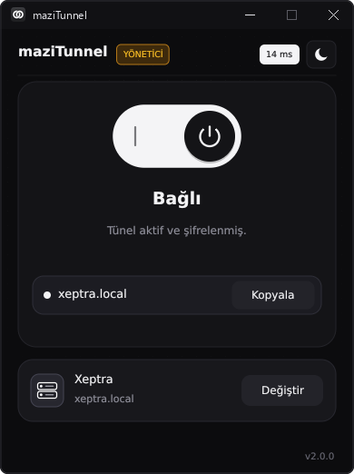
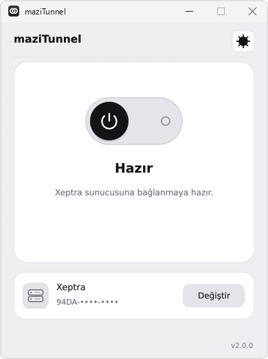
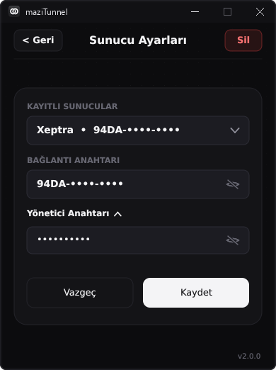
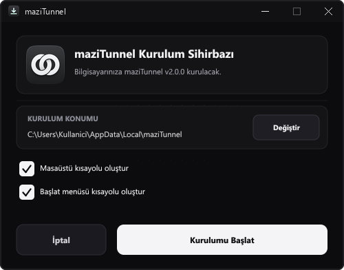
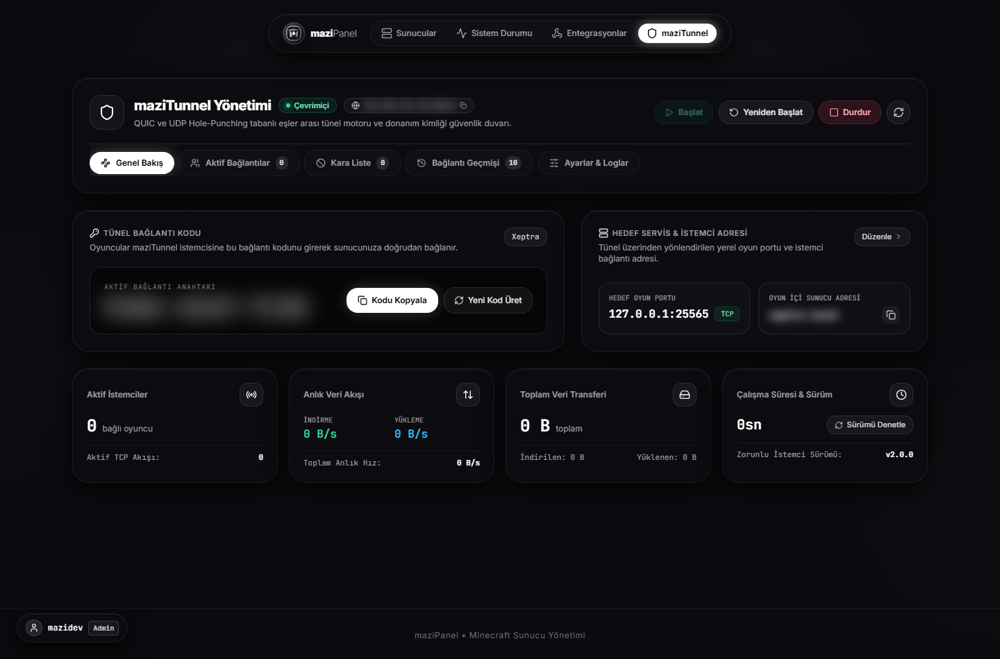

<div align="center">
  
  <h1>maziTunnel</h1>
  <p><strong>CGNAT arkasından port açmadan ve statik IP gerektirmeden doğrudan uçtan uca P2P tünelleme.</strong></p>

  [](#temel-özellikler)
  [](#temel-özellikler)
  [](https://www.rust-lang.org/)
  [](#kurulum-ve-kullanım)
</div>

---

## Genel Bakış

İnternet servis sağlayıcılarının kullandığı **CGNAT (Carrier-Grade NAT)** altyapısı, ev interneti üzerinden dış dünyaya port yönlendirmeyi (Port Forwarding) engeller. Klasik merkezi VPN çözümleri ise trafiği üçüncü bir noktadan dolaştırdığı için gecikmeyi artırır ve hız sınırı oluşturur.

**maziTunnel**, STUN ve şifreli sinyalleşme üzerinden **UDP Hole Punching** yaparak istemci ile sunucu arasında doğrudan uçtan uca bağlantı kurar. Yerel ağda çalışan TCP servislerini (Minecraft sunucusu ve yönetim için SSH) port açmaya veya statik IP adresine ihtiyaç duymadan dış ağa ulaştırır.

Önceki Python tabanlı sürümün yerini alan v2.0.1 sürümü, tamamen **Rust** ile sıfırdan yazılmıştır. Harici bir tarayıcı motoru veya ağır arayüz kütüphanesi kullanmaz; doğrudan Win32 üzerinde çalışan özel çizim motoru sayesinde istemci boyutu **40.11 MB** seviyesinden **2.96 MB** seviyesine düşürülmüş ve çoklu bağlantılardaki paket işleme darboğazları ortadan kaldırılmıştır.

---

## Temel Özellikler

- **Doğrudan NAT Delme (UDP Hole Punching):** STUN uç nokta keşfi ve şifreli sinyalleşme ile CGNAT arkasındaki istemci ve sunucuyu doğrudan eşleştirir; doğrudan geçişin mümkün olmadığı simetrik NAT ağlarında kesintisiz bağlantı sağlar.
- **Uçtan Uca Paket Şifreleme:** Bağlantı el sıkışmasında `X25519` anahtar değişimi ve `HKDF-SHA256` anahtar türetimi kullanılır. Tüm tünel trafiği `ChaCha20-Poly1305` veya `AES-256-GCM` ile şifrelenir ve sıra numarası doğrulamasıyla tekrar (replay) saldırılarına karşı korunur.
- **Sunucu Tarafından Belirlenen Servis Portu ve `.local` Bağlantı Adresi:**
  - Sunucu sahibi, paylaşılacak hedef TCP portunu (varsayılan `25565`) ve istemcilere gösterilecek bağlantı adresini (ör. `xeptra.local`) sunucu yapılandırmasından veya yönetim panelinden belirler.
  - Bağlantı kurulduğunda bu adres istemci ekranında belirir, yerel ağda otomatik çözümlenir ve tek tıkla kopyalanabilir.
- **Rol Tabanlı Port İzolasyonu (ACL):**
  - **Oyuncu (`PLAYER`):** Yalnızca sunucu sahibinin izin verdiği oyun portuna erişebilir; diğer tüm yerel portlar güvenlik katmanında engellenir.
  - **Yönetici (`ADMIN`):** Doğrulanan yönetici anahtarıyla SSH (`22`) ve yönetim portlarına güvenli erişim sağlar.
- **Donanım Kimliği (HWID) Doğrulama:** Anakart, işlemci ve sistem kimliklerinden deterministik olarak üretilen HWID ile cihaz bazlı erişim kontrolü ve kalıcı yasaklama (ban) imkanı sunar.
- **Hafif Masaüstü İstemcisi ve Otomatik Güncelleme:** Koyu ve açık tema desteği, sistem tepsisi (tray) kontrol penceresi ve açılışta Cloudflare R2 üzerinden SHA-256 doğrulamalı otomatik güncelleme desteği içerir.
- **maziPanel Entegrasyonu:** Yerel HTTP API (`127.0.0.1:9090`) üzerinden aktif istemcileri, anlık veri akışını, bağlantı geçmişini, HWID kara listesini ve yüzeysel/detaylı servis loglarını yönetme imkanı sunar.

---

## Arayüzden Görseller

### Masaüstü İstemcisi ve Kurulum Sihirbazı

| Koyu Tema (Bağlı) | Açık Tema (Hazır) |
| :---: | :---: |
|  |  |

| Sunucu Ayarları | Kurulum Sihirbazı |
| :---: | :---: |
|  |  |

### maziPanel Yönetim Ekranı



---

## Çalışma Mimarisi

```text
                  +-----------------------------------------+
                  |      Şifreli Sinyalleşme ve STUN        |
                  |         (Uç Nokta Eşleştirme)           |
                  +-----------------------------------------+
                                 ^           ^
                     Sinyal Alış |           | Sinyal Alış
                                 v           v
[ İstemci (Oyuncu / Admin) ] <===================> [ Sunucu Servisi (Host) ]
      |                            UDP Tünel              |
      |-- Sanal Ağ / Yerel Vekil   X25519 + AEAD          |-- Hedef TCP Servisi (Ör. 25565)
      |-- Özel *.local Adresi                             |-- Sistem SSH Servisi (22)
      |-- Win32 Masaüstü Arayüzü                          |-- maziPanel HTTP API (9090)
```

---

## Kurulum ve Kullanım

### 1. İstemci ile Bağlanma (Windows)

1. `maziTunnelSetup.exe` (veya `maziTunnelSetup.msi`) kurulum dosyasını çalıştırarak uygulamayı kurun.
2. Uygulamayı açıp **Değiştir** butonuna tıklayın ve sunucu bağlantı anahtarını (`XXXX-XXXX-XXXX`) kaydedin.
3. Ana ekrandaki anahtarı sağa kaydırarak bağlantıyı başlatın.
4. Bağlantı kurulduğunda ekranda beliren sunucu adresini **Kopyala** butonuyla kopyalayıp doğrudan oyuna katılın.

### 2. Sunucu Servisini Çalıştırma (Linux)

```bash
./mazitunnel-server --config /mazideveloper/p2ptunnel/config/server_config.json
```

Sunucu başlatıldığında konsolda oyuncularla paylaşabileceğiniz **Bağlantı Kodu**, **Yönetici Şifresi** ve yerel **maziPanel API (`127.0.0.1:9090`)** bilgileri görüntülenir.

```text
Seçenekler:
  -c, --config <YOL>       Özel server_config.json dosya yolu
  -a, --admin-key <ŞİFRE>  Yönetici şifresini geçici olarak belirle
  --mazipanel              maziPanel entegrasyon modunda çalış
  --standalone             Bağımsız konsol modunda çalış
  -v, --verbose            Konsola detaylı teknik logları yazdır
```

---

## Kaynak Koddan Derleme

### Gereksinimler

- Rust 1.80+ (`cargo`, `rustc`)
- Linux üzerinden Windows çapraz derlemesi için: `mingw-w64` (`x86_64-pc-windows-gnu`) ve MSI paketi için `wixl` (`msitools`)

### Derleme Komutları

```bash
# Depoyu klonlayın
git clone https://github.com/Mazi0182/maziTunnel.git
cd maziTunnel

# Mevcut platform için release derlemesi
cargo build --release

# Tüm Linux ve Windows dağıtım paketlerini (EXE + Setup + MSI) üretme
chmod +x build_release.sh
./build_release.sh
```

`build_release.sh` tamamlandığında `dist/` klasöründe şu dosyalar üretilir:
- `dist/mazitunnel-server` — Linux x64 sunucu servisi (`1.42 MB`)
- `dist/maziTunnel.exe` — Windows x64 masaüstü istemcisi (`2.96 MB`)
- `dist/maziTunnelSetup.exe` — Windows x64 çevrim içi/çevrim dışı kurulum sihirbazı (`4.07 MB`)
- `dist/maziTunnelSetup.msi` — Standart Windows Installer paketi (`2.21 MB`)
- `dist/maziTunnelUninstall.exe` — Kaldırma aracı (`510 KB`)

---

## Proje Yapısı

```text
maziTunnel/
├── assets/                        # Uygulama ikonları, yazı tipleri ve ekran görüntüleri
├── crates/
│   ├── mazitunnel-core/           # Protokol, X25519/AEAD şifreleme, STUN/NAT ve deterministik HWID
│   ├── mazitunnel-client/         # Windows masaüstü istemcisi, 250 FPS yazılım çizim motoru ve tepsi menüsü
│   ├── mazitunnel-server/         # Çoklu istemci sunucu servisi, ACL, HWID ban/geçmiş ve maziPanel API
│   └── mazitunnel-installer/      # Kurulum sihirbazı (maziTunnelSetup) ve kaldırma aracı (Uninstall)
├── build_release.sh               # Linux ve Windows çapraz derleme betiği
├── installer.wxs                  # WiX MSI paket şablonu
├── publish.py                     # Cloudflare R2 güncelleme dağıtım betiği
└── Cargo.toml                     # Cargo çalışma alanı yapılandırması
```

---

## Lisans

Bu proje [MIT Lisansı](LICENSE) altında lisanslanmıştır.
